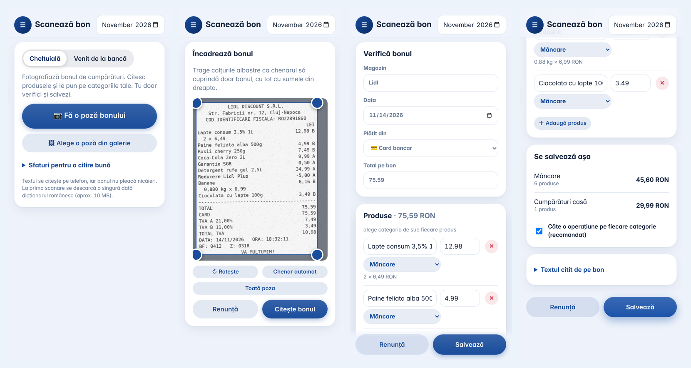

# 💰 Bugetul Meu

Aplicație web de buget personal, în limba română, care rulează direct în browser și se poate instala pe telefon ca o aplicație (PWA). **Datele rămân doar pe dispozitivul tău**: nu există server, cont sau abonament.


> Capturile folosesc date de demonstrație.

## ✨ Funcții

| Zonă | Ce poți face |
|---|---|
| **Acasă** | Avere netă, venituri, cheltuieli, rambursări, grafic pe categorii, tendință pe 6 luni, „Pot cheltui azi", bugete și alerte |
| **Adaugă** | Cheltuieli, încasări (și în **EUR/USD**, cu curs manual), rambursări de datorii și transferuri între Card și Numerar |
| **Istoric** | Căutare, filtre pe tip, dată, sumă, cont și categorie; selecție multiplă cu ștergere, recategorisire și mutare de cont în masă (cu anulare); editare, duplicare și ștergere |
| **Rapoarte** | 11 rapoarte. **Rezumat** pe orice perioadă (lună, 3/6/12 luni, an sau interval ales) cu concluzii în text, comparație cu perioada anterioară și export CSV. Apoi: Prezentare (flux Sankey, evoluția soldului, recurente, hartă termică), Bugete, Categorie, Datorii și economii, Conturi și tichete, Prognoză, An, Venituri, Comercianți și Compară luni |
| **Planificare** | Calendar lunar cu salarii și facturi, înregistrare manuală sau automată |
| **Economii** | Obiective cu progres, contribuții și retrageri |
| **Persoane** | Cine îți datorează și cui datorezi, cu istoric și împrumuturi |
| **Datorii** | Creditori, sume totale și cât a rămas de plătit |
| **Carduri tichete** | Carduri de masă sau cadou, cu alimentări și plăți din sold. Cardurile vechi din V22 se convertesc într-un singur clic, cu verificarea soldului |
| **Setări** | Solduri inițiale, bugete lunare, categorii proprii, backup și import JSON |
| **Editare și ștergere** | Orice înregistrare se poate edita sau șterge: operațiuni (cu duplicare), carduri și alimentările lor, datorii, împrumuturi, obiective și mișcările lor, evenimente planificate, categorii. Ștergerile mari cer confirmare, iar cele simple au „Anulează” |

Interfața are meniu lateral, butoane rotunde în stil iOS, albastru închis, mod întunecat, și se adaptează atât pe telefon, cât și pe desktop.

<p>
</p>

### 📊 Rapoarte


### 🧾 Noutăți V30: produse și prețuri

- **Produsele în istoric:** la cheltuielile scanate apare „🧾 N produse”. Atingi și vezi fiecare produs, cu prețul și cantitatea lui.
- **Căutare după produs:** în *Istoric*, căutarea „kefir” găsește bonurile care au kefir. Nu contează diacriticele și nici literele mari.
- **Raportul Produse** (*Rapoarte → Produse*): ce s-a scumpit sau s-a ieftinit, la ce magazin e mai ieftin, ce cumperi cel mai des, pe ce dai cei mai mulți bani și istoricul de preț al fiecărui produs. Prețul se calculează pe bucată sau pe kg. Produsele scrise ușor diferit pe bonuri („Kefir 1,5%” și „KEFIR 1.5%”) se grupează împreună.

### 📷 Noutăți V29: scanare bonuri



- **Scanează bon** (meniu sau butonul din *Adaugă*): fotografiezi bonul, potrivești chenarul și aplicația citește produsele, prețurile, totalul, data, magazinul și modul de plată (card, numerar, tichete).
- **Pe categoriile tale:** fiecare produs primește una dintre categoriile aplicației (Mâncare, Cumpărături casă, Sănătate, Transport…). Bonul se salvează ca o operațiune pe fiecare categorie sau, dacă vrei, ca una singură. Nota este magazinul, deci apare corect și în raportul *Comercianți*.
- **Învață din corecturi:** când schimbi categoria unui produs, data viitoare îl încadrează singur (lista e în *Setări → Scanare bonuri*).
- **Verificare:** suma produselor se compară cu totalul bonului. O sumă citită greșit se corectează singură când cantitatea × prețul o confirmă. Bonurile deja salvate sunt semnalate.
- **Chitanță de la bancă:** depunerea se salvează ca venit sau ca transfer *Numerar → Card*.
- **Toate fișierele stau direct în rădăcina repository-ului, fără foldere.** **Fără internet și fără servere:** textul se citește pe telefon (Tesseract, limba română: `tesseract.min.js`, `worker.min.js`, `tesseract-core-*.wasm.js`, `ron.traineddata`). Bonul nu pleacă nicăieri. Prima scanare descarcă o singură dată aproximativ 10 MB.

### ✨ Noutăți V28


- **Monede:** introduci o cheltuială sau un venit în EUR/USD, cu cursul tău. Suma se salvează în RON (soldurile și rapoartele rămân în RON), iar suma originală și cursul se păstrează și apar în Istoric și rapoarte.
- **Operațiuni în masă:** în *Istoric* apeși *Selectează*, bifezi și alegi ștergere, categorie sau cont.
- **Interfață:** iconițe SVG, antet translucid, butoane și animații fine; respectă setarea „reducere mișcare".

## 📱 Instalare pe telefon

**iPhone (Safari):** deschide linkul aplicației → *Distribuie* → *Adaugă pe ecranul principal*.

**Android (Chrome):** deschide linkul → meniul ⋮ → *Instalează aplicația*.

După prima încărcare, aplicația funcționează și fără internet.

## 🚀 Publicare pe GitHub Pages

Toate fișierele stau direct în rădăcina repository-ului, **fără foldere**, deci se pot urca și de pe iPhone.

1. În repository: **Add file → Upload files**, selectează toate fișierele și apasă **Commit changes**.
2. **Settings → Pages**: la *Source* alege **Deploy from a branch**, ramura `main`, folderul `/ (root)`.
3. Aplicația se publică la `https://<utilizator>.github.io/<repository>/`.

Dacă după o actualizare vezi versiunea veche, închide tabul și redeschide linkul. Service worker-ul își reîmprospătează singur memoria cache.

## 🔒 Securitate și siguranța datelor

- **Stocare dublă:** datele se salvează în **IndexedDB** și în **localStorage** (cheia `bugetul-meu-v1`). La pornire se alege automat copia validă și cea mai recentă.
- **Sumă de control (SHA-256):** o copie coruptă este detectată, ignorată și reparată din cealaltă. Copiile corupte se păstrează pentru analiză.
- **Instantanee automate:** unul pe zi (ultimele 20), plus unul înainte de import, restaurare sau conversie. Se pot restaura din *Setări*.
- **Stocare persistentă:** aplicația cere browserului să nu șteargă datele. Pe iPhone, adaug-o pe ecranul principal.
- **Verifică stocarea:** buton în *Setări* care testează scrierea/citirea, integritatea copiilor, spațiul folosit și persistența.
- **Parolă cu criptare:** datele se criptează cu AES-256-GCM, cheia derivată din parolă (PBKDF2, 250.000 de iterații). **Fără parolă datele nu pot fi citite de nimeni, inclusiv de tine.**
- **Face ID / Touch ID:** blocare prin WebAuthn (iOS 16+, necesită HTTPS), cu parolă de rezervă. Este o **blocare a accesului în aplicație, nu o criptare**.
- **Blocare automată:** imediat, după 30 de secunde, 1 minut, 5 minute sau niciodată.
- **Import validat:** backup-ul este verificat (format, date, sume, id-uri duplicate), iar înregistrările invalide sunt ignorate, cu avertisment.

> ⚠️ Nu există recuperare de parolă. Păstrează un backup JSON recent și nu-l urca pe GitHub: conține finanțele tale.
> Nicio dată nu este trimisă pe internet. Dacă ștergi datele site-ului din browser, le pierzi, de aceea backup-ul rămâne important.


## 🗂 Structura proiectului

Toate fișierele sunt în rădăcină:

```
index.html            # structura paginii
store.js              # stocare sigură, criptare, Face ID, instantanee
app.css               # stiluri, temă luminoasă/întunecată, responsive
core.js               # date, solduri, ecranele de bază
features.js           # planificare, economii, persoane, carduri, setări
dashboard.js          # ecranul Acasă și grafice
reports.js            # rapoartele
crud.js               # editare și ștergere
security-ui.js        # securitate, import, conversie carduri
v28.js                # filtre, selecție în masă, monede, Rezumat
bon-parser.js         # citirea bonului fiscal din text + încadrare
scanner.js            # scanare bonuri: poză, chenar, verificare, salvare
produse.js            # raportul Produse: prețuri, magazine, scumpiri
main.js               # randare și evenimente globale
tesseract.min.js, worker.min.js, tesseract-core-lstm.wasm.js,
tesseract-core-simd-lstm.wasm.js, ron.traineddata   # cititorul de text (Tesseract.js + limba română)
sw.js                 # service worker (funcționare offline)
manifest.webmanifest  # configurare PWA
icon-180/192/512.png  # iconițe
v29-scanare.png       # captură pentru acest README
```

## 🛠 Tehnologii

HTML, CSS și JavaScript simplu, fără framework. Singura bibliotecă externă este [Tesseract.js](https://github.com/naptha/tesseract.js) (licență Apache 2.0), inclusă în repository și încărcată doar la scanare. Graficele sunt făcute din SVG și CSS.

## 🧪 Rulare locală și teste

```bash
python3 -m http.server 8000
# apoi deschide http://localhost:8000
```

Service worker-ul are nevoie de `http://localhost` sau `https`. Deschis direct din fișier, aplicația merge, dar fără mod offline.

## 🗺 Idei pentru viitor

- Import din extras bancar (BT, ING, Revolut)
- Conturi și solduri în mai multe monede
- Operațiuni recurente cu reguli mai complexe
- Import din extrasul bancar (CSV)
- Sincronizare opțională între dispozitive

## 📄 Licență

Proiect personal. Alege o licență (de exemplu MIT) înainte de a-l face public.
